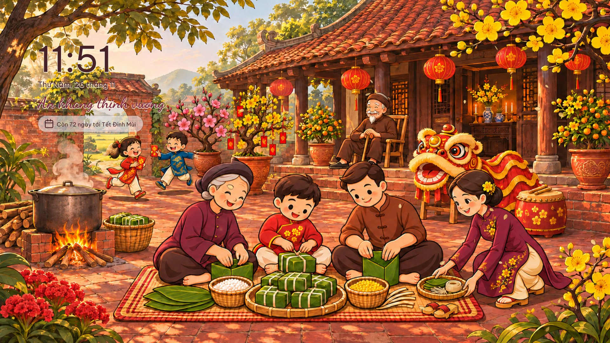
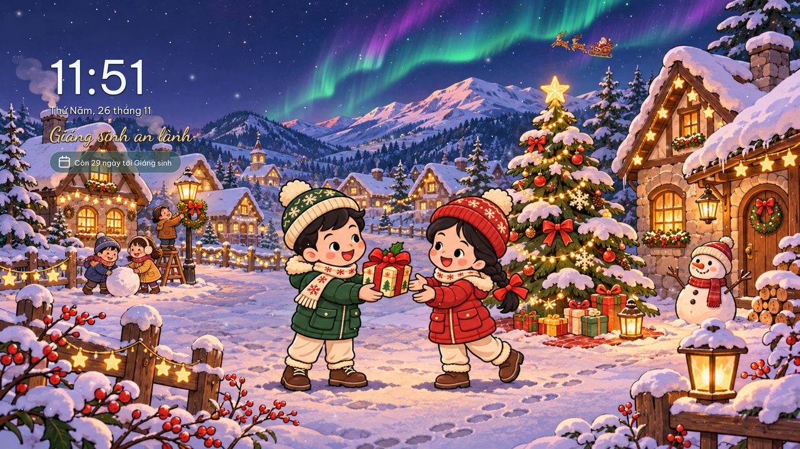
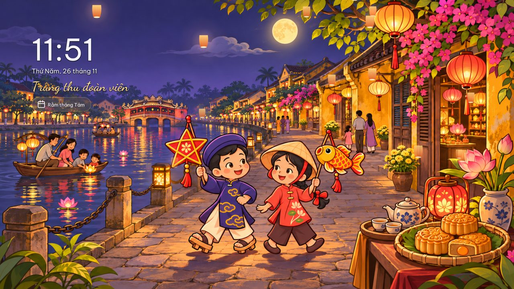
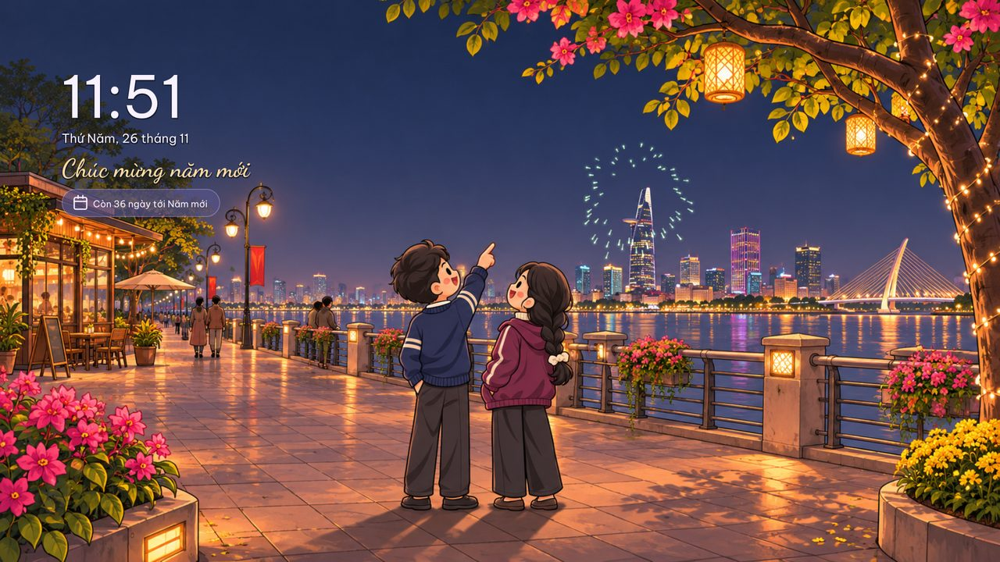
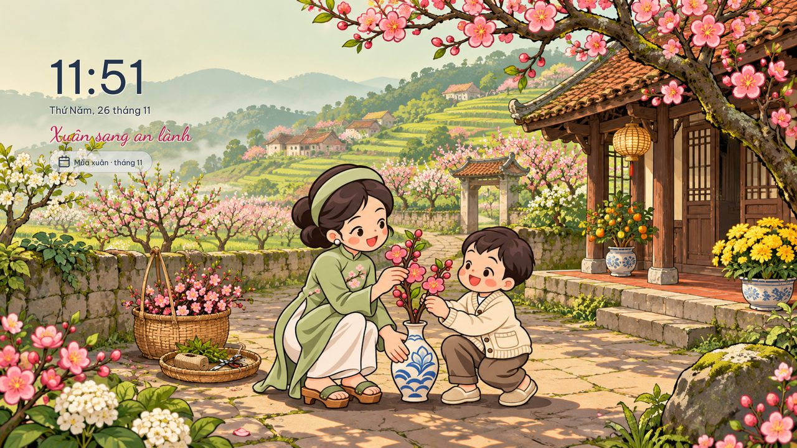
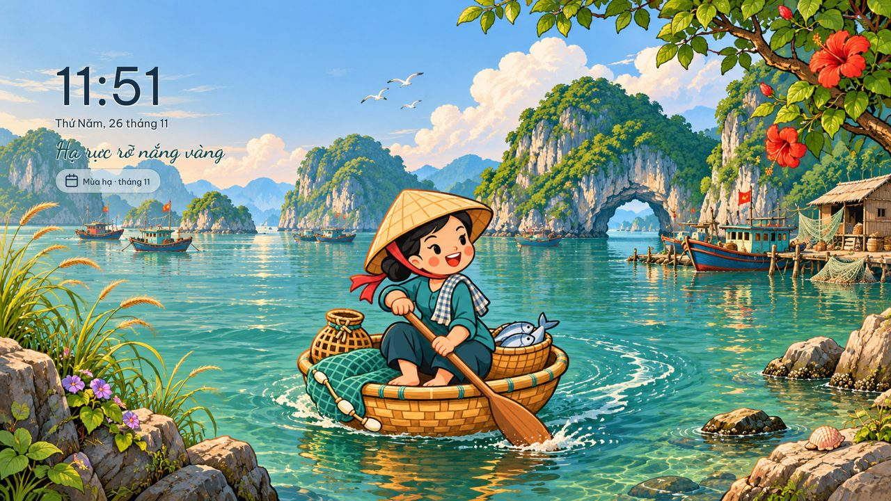
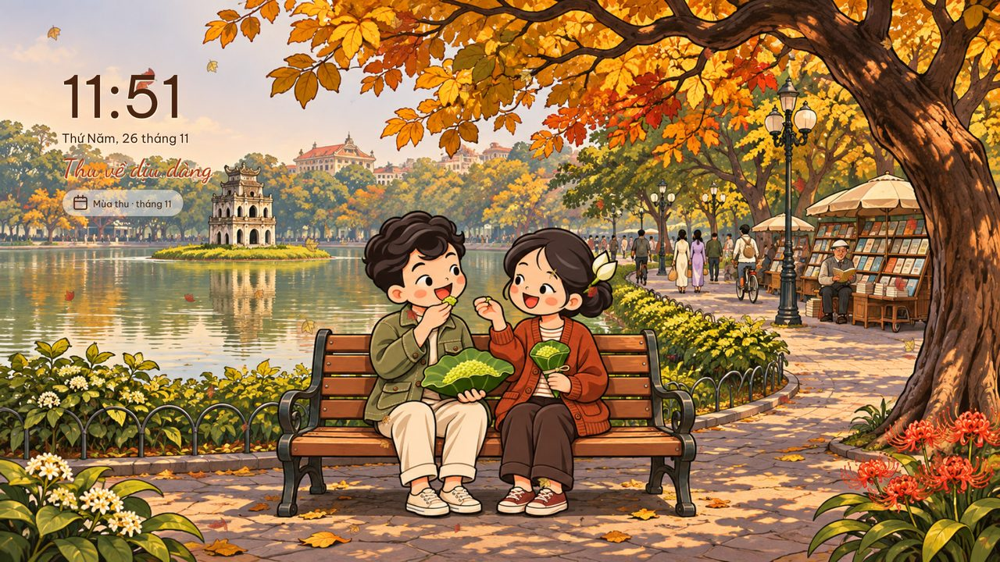
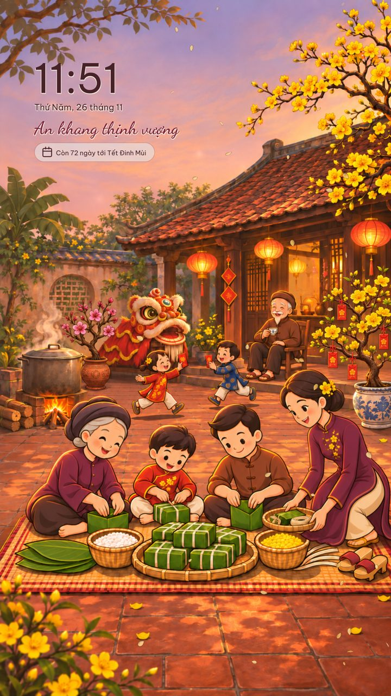
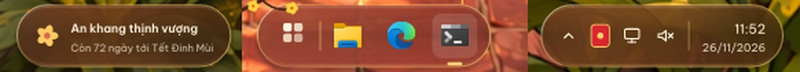
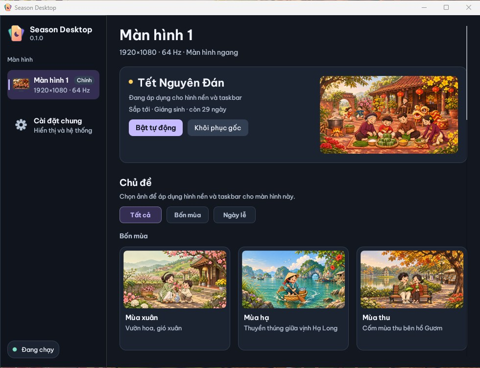

<div align="center">

# Season Desktop

**Seasonal live wallpaper and a themed taskbar for Windows 10/11, written in Rust.**

[](https://github.com/neknaut/season-desktop/releases/latest)
[](https://github.com/neknaut/season-desktop/releases)
[](#requirements)
[](https://www.rust-lang.org)
[](https://github.com/neknaut/season-desktop/actions/workflows/release.yml)

[**Download**](https://github.com/neknaut/season-desktop/releases/latest) ·
[Screenshots](#screenshots) ·
[Features](#features) ·
[Install](#install) ·
[Build from source](#build-from-source) ·
[Changelog](CHANGELOG.md)



<sub>Lunar New Year (Tết) theme: the clock, the date, the greeting <i>“An khang thịnh vượng”</i> and a countdown to
Tết are drawn on the wallpaper.</sub>

</div>

---

Season Desktop draws an animated, hand-painted scene under the desktop icons and can replace the Windows taskbar
with a "three island" glass taskbar that follows the same theme. Themes change automatically with the four seasons
and with Vietnamese and international holidays, and every scene shows the time, the date and a greeting for the
occasion.

## Screenshots

### Wallpapers

Every theme shows the current time, the date, a greeting and a countdown to the next holiday.

<table>
  <tr>
    <td width="50%"><br>
      <sub><b>Christmas</b> · “Giáng sinh an lành” · snow and Santa's sleigh</sub></td>
    <td width="50%"><br>
      <sub><b>Mid-Autumn Festival</b> · “Trung thu đoàn viên” · sky lanterns</sub></td>
  </tr>
  <tr>
    <td width="50%"><br>
      <sub><b>New Year</b> · “Chúc mừng năm mới” · fireworks over the city</sub></td>
    <td width="50%"><br>
      <sub><b>Spring</b> · “Xuân sang an lành” · falling blossoms</sub></td>
  </tr>
  <tr>
    <td width="50%"><br>
      <sub><b>Summer</b> · “Hạ rực rỡ nắng vàng” · Hạ Long Bay</sub></td>
    <td width="50%"><br>
      <sub><b>Autumn</b> · “Thu về dịu dàng” · falling leaves by Hoàn Kiếm Lake</sub></td>
  </tr>
</table>

Portrait monitors get their own layout:

<p align="center">
  
</p>

### Themed taskbar

Three glass islands: the greeting and holiday countdown (or the song that is playing), Start with the pinned and
running apps, and the system tray with network, volume, clock and calendar.

<p align="center">
  
</p>

### Settings

Pick a theme per monitor, turn on automatic mode or restore the Windows defaults.

<p align="center">
  
</p>

## Features

- **Live wallpaper** under the desktop icons, one scene per monitor, with landscape and portrait layouts.
- **Clock and greeting on the wallpaper**: time, date, a greeting for the theme and a countdown to the next
  holiday (for example *“Còn 72 ngày tới Tết Đinh Mùi”*).
- **20 themes**: spring, summer, autumn, winter, Lunar New Year, New Year, Christmas, Mid-Autumn, Valentine's Day,
  Hung Kings Commemoration, Tết Đoan Ngọ, Vietnamese Remembrance Day (July 27), Vietnamese Culture Day
  (November 24), International Women's Day, Vietnamese Women's Day, Reunification Day, National Day,
  Children's Day, Teachers' Day and Halloween.
- **Automatic mode**: the seasonal theme on normal days; the holiday theme starts 3 days before a holiday
  (1 week before Christmas and New Year, 1 month before Lunar New Year).
- **Light on resources**: only meaningful motion is animated (apricot blossoms, snow and Santa's sleigh,
  fireworks, falling leaves, sky lanterns). Static scenes redraw every 2 seconds, and rendering pauses while a
  fullscreen or maximized window covers the wallpaper.
- **Themed taskbar** (optional, per monitor):
  - left: now playing (click to play/pause) or the theme greeting with a holiday countdown;
  - center: Start and the same pinned and running apps as the Windows taskbar, in the same order; window
    grouping, live previews, jump lists, drag to reorder;
  - right: system tray icons (forwarded to Windows), hidden-icons flyout, network, volume, battery, clock and
    calendar;
  - secondary monitors show only the center island.
- **Settings window**: theme gallery per monitor, automatic mode, restore Windows defaults per monitor,
  effects, frame-rate limits, start with Windows, close to tray or quit.
- **Safe by design**: no admin rights, and everything it changes in Windows is restored on exit, uninstall or
  crash (see [How it stays safe for Windows](#how-it-stays-safe-for-windows)).

## Requirements

- Windows 10 or 11, x64.
- A GPU supported by [wgpu](https://wgpu.rs) (Direct3D 12 or Vulkan).

## Install

1. Download `SeasonDesktop-<version>-x64.msi` from the
   [latest release](https://github.com/neknaut/season-desktop/releases/latest) and run it. It installs for the
   current user into `%LOCALAPPDATA%\Programs\Season Desktop` (no admin rights) and adds Start menu and desktop
   shortcuts.
2. The app opens after installation. Pick a monitor and click a theme, or turn on **Automatic**.
3. To update, run a newer MSI; it closes the running app and replaces the old version.

> [!NOTE]
> The installer is not code-signed, so Windows SmartScreen may show a warning. Click **More info → Run anyway**.

To uninstall, use **Settings → Apps → Installed apps → Season Desktop → Uninstall**. The app restores the Windows
taskbar and wallpaper and removes itself from startup. Your settings in `%APPDATA%\season-desktop` are kept;
delete that folder to remove them.

Silent install and uninstall:

```powershell
msiexec /i SeasonDesktop-0.1.0-x64.msi /qn
msiexec /x SeasonDesktop-0.1.0-x64.msi /qn
```

## Usage

### Command-line options

The installed `season-desktop.exe` accepts:

| Option | Description |
| --- | --- |
| *(none)* | Start the app and open the settings window |
| `--minimized` | Start in the background (used when starting with Windows) |
| `--restore` | Stop the running app and restore the Windows taskbar and wallpaper |
| `--snapshot <dir>` | Render all 20 themes (landscape and portrait) to PNG files without touching the desktop |
| `--export-icon <file.ico>` | Export the app icon |
| `--quit-app`, `--uninstall-app` | Used by the installer to close the app / clean up before uninstalling |

### Configuration and custom art

- Settings: `%APPDATA%\season-desktop\config.toml` (written by the settings window; edits are picked up
  automatically).
- Log: `%APPDATA%\season-desktop\log.txt`.
- Custom art per theme in `%APPDATA%\season-desktop\art\<theme>\` (transparent PNG):
  `nen.png` (background), `nguoi.png` (people), and for Lunar New Year `lan.png` (lion dance) and
  `giadinh.png` (family scene).

### Diagnostics

Set these environment variables before starting the app:

| Variable | Effect |
| --- | --- |
| `SEASON_PROFILE=1` | Logs timings of each part of the frame loop every 5 seconds |
| `SEASON_TRAY_DUMP=1` | Writes the tray icons received from apps to `tray-dump.txt` |
| `SEASON_ORDER_DEBUG=1` | Logs how taskbar apps are matched to the Windows taskbar order |

## Build from source

Requirements:

- [Rust](https://rustup.rs) (stable, MSVC toolchain);
- Visual Studio Build Tools with the **Desktop development with C++** workload and a Windows SDK
  (`rc.exe` embeds the app icon);
- **WiX Toolset 3.14** (`candle.exe` and `light.exe`), only to build the installer. The script looks in
  `%WIX%\bin`, `PATH`, `%LOCALAPPDATA%\tauri\WixTools314` and the default WiX 3.14 install folder.

### Run without installing

```powershell
cargo run --release
```

`cargo run` builds `target\release\season-desktop.exe` and starts it. Only one instance runs at a time: starting
the app again just opens the settings window of the instance that is already running. If the installed version
is running, quit it first so that your test build starts instead: right-click the tray icon →
**Thoát Season Desktop**, or run:

```powershell
& "$env:LOCALAPPDATA\Programs\Season Desktop\season-desktop.exe" --quit-app
```

### Build the installer

Releases are shipped as an MSI installer only. From the project folder, run:

```powershell
powershell -NoProfile -ExecutionPolicy Bypass -File .\scripts\build-installer.ps1
```

The script compiles the app in release mode and packages it into `dist\SeasonDesktop-<version>-x64.msi`.
MSI versions must be numeric (major and minor ≤ 255, patch ≤ 65535).

## Releases

Releases are built and published by GitHub Actions
([`.github/workflows/release.yml`](.github/workflows/release.yml)). Commits and pull requests start nothing; the
workflow runs only when a merge into `main` changes `Cargo.toml`, where the version lives:

| Merge into `main` | Result |
| --- | --- |
| `Cargo.toml` version has no `v<version>` tag yet | Builds the MSI on a Windows runner, creates the tag `v<version>` and publishes a GitHub Release with only the MSI attached and the matching `CHANGELOG.md` section as release notes |
| Version already released, or `Cargo.toml` not changed | Nothing is built or published |

Compiled Rust dependencies and the WiX binaries are cached between releases, so only the app itself is rebuilt
when its dependencies have not changed. GitHub drops caches that are unused for 7 days, so the first release
after a long pause builds from scratch.

To release a new version:

1. In a pull request, bump `version` in `Cargo.toml` (run `cargo check` so `Cargo.lock` follows) and add a
   `## [x.y.z] - YYYY-MM-DD` section to `CHANGELOG.md`.
2. Merge the pull request into `main`. The release appears under
   [Releases](https://github.com/neknaut/season-desktop/releases) a few minutes later.

If a release build fails, fix it and merge again, or start the workflow by hand from the **Actions** tab
(**Release → Run workflow**). Never reuse a version: Windows Installer uses it to decide whether an MSI is an
upgrade.

## Project structure

```text
season-desktop/
├── src/
│   ├── main.rs          Event loop: wallpapers per monitor, taskbars, settings window, tray icon
│   ├── config.rs        Settings file and the automatic theme calendar
│   ├── lunar.rs         Solar-to-lunar date conversion for the taskbar calendar
│   ├── desktop.rs       Attach under desktop icons, monitors, original wallpaper, start with Windows
│   ├── gfx.rs           wgpu renderer
│   ├── draw.rs          Per-frame sprite list sent to the GPU
│   ├── paint.rs         CPU drawing helpers (tiny-skia)
│   ├── widget.rs        Clock, greeting and countdown on the wallpaper
│   ├── settings.rs      Settings window (egui)
│   ├── tray.rs          App tray icon and app icon
│   ├── taskbar.rs       Windows taskbar accent colours (backed up and restored)
│   ├── scenes/          Themes: painted backgrounds, foregrounds, effects, figures
│   └── bar/             Themed taskbar
│       ├── mod.rs       Layout, drawing, input, animations
│       ├── shell.rs     Windows integration: windows, pins, app IDs, icons, audio, network
│       ├── systray.rs   System tray host (forwards everything to Windows)
│       ├── menu.rs      Context menus
│       ├── preview.rs   Window previews
│       ├── jumplist.rs  Jump lists
│       └── media.rs     Now playing
├── shaders/             WGSL shaders
├── assets/              Icon, fonts, painted backgrounds, foregrounds, theme previews
├── installer/           WiX installer source and license text
├── scripts/             Build scripts
├── docs/images/         README screenshots
├── .github/workflows/   Automatic MSI releases on version bumps
├── build.rs             Embeds the app icon into the executable
├── CHANGELOG.md
└── README.md
```

## How it stays safe for Windows

- Writes only to the current user's registry hive (HKCU); no admin rights.
- The Windows taskbar is only **hidden**, never removed. Its original state (and any accent colour change) is
  backed up and restored on exit, restore, uninstall or crash (a watchdog process handles crashes).
- The tray host forwards every message to the Windows tray, so Windows keeps its full state.
- Pinned apps and their order are **read** from Windows and never written back.
- The original wallpaper of each monitor is saved before a still image is set, so it can be restored.

## Known limitations

- Pin and unpin apps on the Windows taskbar or Start menu; the themed taskbar follows immediately. Windows does
  not let other apps pin, and unpinning through the API makes Windows rewrite the pin list.
- Tray icons owned by `SYSTEM` processes (for example NVIDIA) or sent without a callback (Windows Security)
  cannot show their own context menu; clicking them opens the related app.
- The order of running, unpinned apps is read from the Windows taskbar while it is visible on some monitor and
  remembered afterwards.

## Third-party assets

Be Vietnam Pro and Dancing Script are licensed under the SIL Open Font License
(see `assets/fonts/OFL-*.txt`).
